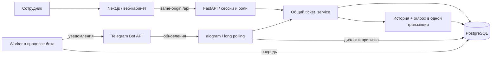

# Архитектура

## Веб и HTTP

Next.js расположен непосредственно в корне. Layout и metadata — серверные компоненты; интерактивный кабинет — клиентский компонент. API-клиент не хранит пароли или токены в localStorage. `/api/*` проксируется Next.js к FastAPI. Адрес backend фиксируется в сборке. Сессия и CSRF-cookie остаются в том же origin, что и интерфейс; CORS не открыт. Ответы API имеют `Cache-Control: no-store`. В JSON ошибок нет SQL, входных паролей и traceback.

Реализация опирается на [официальный механизм rewrites Next.js](https://nextjs.org/docs/app/api-reference/config/next-config-js/rewrites) и встроенную в установленный пакет документацию standalone output. Для локального production-сервера startup копирует static/public и запускает standalone `server.js`.

## База и транзакции

Сохранён синхронный SQLAlchemy из существующей заготовки. Все обработчики БД и зависимости — `def`; FastAPI выполняет их в пуле потоков. Блокирующего SQL внутри async-обработчиков нет. Одна Session на запрос; commit на границе бизнес-операции, при ошибке закрытие сессии откатывает транзакцию. SQLite: foreign keys, WAL, busy timeout 15 с, отдельные соединения. Unicode casefold для SQLite `lower` обеспечивает поиск по русским буквам. PostgreSQL использует тот же набор моделей и сервисов через psycopg, но сегодня фактически не запускался.

Модели: Staff, ServerSession, CategoryGroup, CategoryItem, Applicant, Ticket, History, Notification, SystemState, LoginAttempt. Время хранится как UTC без timezone в переносимом DateTime; UI и календарные фильтры используют Москву. Индексы покрывают номер, статус, дату, исполнителя, категории, Telegram user ID, сессии, окно лимитера и очередь.

Alembic содержит явную первоначальную миграцию с таблицами, индексами и ограничениями. Она не вызывает `metadata.create_all` и не зависит от будущего изменения моделей. Для SQLite включён `render_as_batch`. Bootstrap применяет миграции, использует маркеры первичной инициализации и не сбрасывает справочники или учётные записи. Рабочие заявки автоматически не создаются.

## Жизненный цикл и конкуренция

`ticket_service.create_ticket` валидирует группу/элемент, активность и создаёт заявителя, снимок имени/контакта, заявку и историю. Номер формируется из присвоенного БД первичного ключа. SQLite AUTOINCREMENT и PostgreSQL sequence обеспечивают уникальные ID; пробелы в номерах допустимы.

`apply_action` проверяет ожидаемую версию, статус и исполнителя. [SQLAlchemy version_id_col](https://docs.sqlalchemy.org/en/20/orm/versioning.html) добавляет проверку версии в UPDATE. Конкурирующая запись вызывает `StaleDataError`, возвращаемый как 409, без частичной истории или уведомления. Обновление заявки, History и outbox выполняются одной транзакцией. Назначение не меняет статус; закрытие только из in_progress. Результат и дата закрытия защищены дополнительно CHECK-ограничением.

Справочники деактивируются, а связи с историческими заявками сохраняются. Изменение имени категории отображается и в старых карточках; это текущий классификатор, не версионированный справочник. Контакт заявителя в заявке — отдельный неизменяемый снимок.

## Доступ

Пароли — Argon2id. Клиент получает случайный 256-битный токен в HttpOnly SameSite=Lax cookie, в БД сохраняется SHA-256. Срок по умолчанию 12 ч; logout отзывает запись. Каждый запрос проверяет активность сотрудника. Смена пароля/роли и деактивация отзывают его сессии. CSRF-токен также привязан хешем к серверной сессии; изменяющие запросы требуют `X-CSRF-Token`. Origin и Sec-Fetch-Site дополнительно проверяются. До входа браузерный login защищён Origin/SameSite; доверенные CLI-клиенты могут работать без Origin.

Лимит входа хранится в БД по хешу непосредственного IP, без доверия forwarded-заголовкам. Обновление `login_guard` сериализует счётчик между процессами. За Next.js один backend-IP означает общий локальный лимит 10 входов / 300 с: для большого production нужен отдельный проверенный reverse-proxy limiter и доверенная схема определения клиента. Защита последнего администратора сериализуется отдельной записью `staff_guard` и проверяется внутри транзакции.

## Telegram и outbox

Бот aiogram 3 — отдельный процесс с long polling и последовательной обработкой обновлений. Диалоги и подтверждённые запросы сохраняются в БД. Telegram ID заявителя берётся из Update, доступ к номеру заявки проверяется по владельцу.

Сотрудник получает ссылку в авторизованном кабинете: одноразовый token хранится в виде хеша, срок 10 минут; Telegram связывает доверенный user ID со Staff. Привязка уникальна, есть отвязка.

Общий сервис записывает уведомления администраторам о создании, исполнителю о назначении, заявителю о статусах. Worker в процессе бота забирает очередь с арендой, подтверждает доставку после Telegram API и повторяет временные ошибки. Перед отправкой сотруднику проверяет привязку, активность и назначение. Внешняя доставка допускает повтор после аварии между отправкой и commit. [Подробности и запуск](telegram-next-stage.md).
